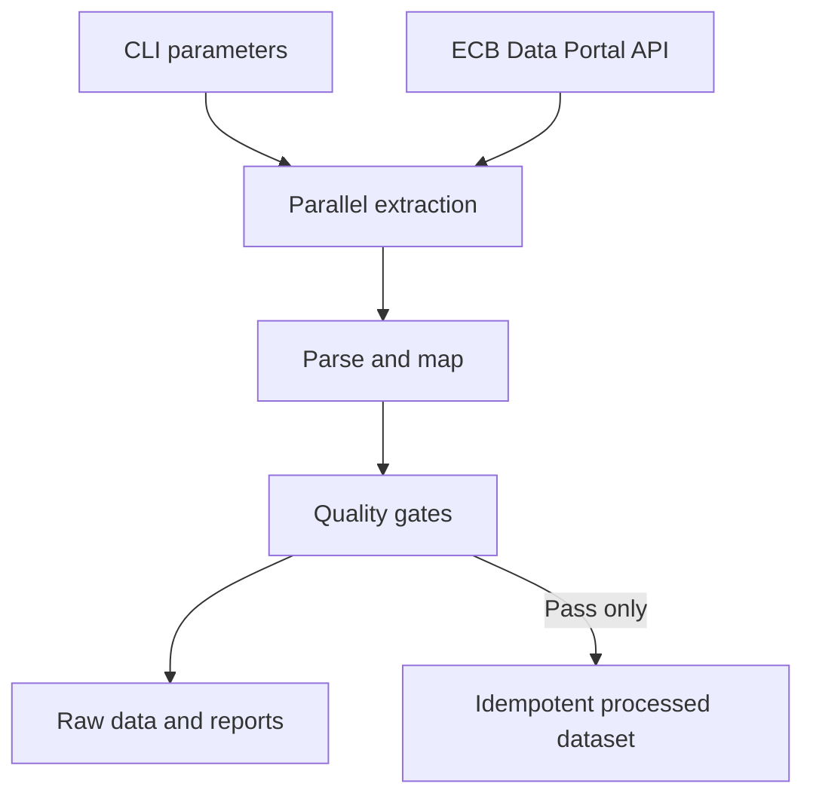

# ECB FX Market Data Pipeline

[](https://github.com/gbadedata/ecb-market-data-pipeline/actions/workflows/ci.yml)
[](https://github.com/gbadedata/ecb-market-data-pipeline/actions/workflows/scheduled-ingestion.yml)
[](https://dotnet.microsoft.com/download/dotnet/8.0)
[](LICENSE)

A focused C#/.NET 8 data pipeline for retrieving daily foreign-exchange reference rates from the European Central Bank, validating them against an explicit data contract, and publishing reproducible analytical outputs.

The default configuration ingests GBP, USD, JPY and CHF rates against EUR. The project is deliberately file-backed and small enough to review end to end, while still implementing the controls expected in a reliable ingestion workload: bounded retries, strict parsing, quality gates, idempotent writes, source-level provenance, automated tests and scheduled execution.

> **Scope:** ECB reference rates are intended for information purposes. They are not real-time market feeds or tradable prices.

## Engineering guarantees

| Capability | Implementation |
| --- | --- |
| Authoritative source | Official ECB Data Portal SDMX 2.1 API and `EXR` dataflow |
| Deterministic extraction | Inclusive date bounds and one explicit series key per requested currency |
| Resilient HTTP access | Parallel requests, 45-second timeout, and up to four attempts for HTTP 429 and 5xx responses |
| Contract enforcement | Required-column, row-width, date and decimal validation; malformed input fails rather than being silently discarded |
| Data-quality controls | Currency, positivity, date-range, uniqueness, presence, freshness and weekday-coverage rules |
| Idempotent publication | Merge by observation date, base currency and quote currency; repeat runs do not append duplicate business keys |
| Traceability | Raw response retention plus request URI, retrieval time, byte count and SHA-256 digest for every source |
| Safe file updates | UTF-8 output written to a temporary file and atomically moved into place |
| Delivery controls | Warnings-as-errors builds, xUnit tests, pull-request CI and scheduled live ingestion |

## Architecture



The application separates the source client, mapping logic, quality evaluation and persistence behind focused components. This keeps failure behaviour testable and allows the file store or ECB client to be replaced without rewriting the pipeline orchestration.

More detail is available in [Architecture and decisions](docs/architecture.md).

## Data source and series definition

The pipeline calls the [ECB Data Portal API](https://data.ecb.europa.eu/help/api/overview) using the official exchange-rate dataflow. Each currency uses this series-key pattern:

```text
D.{QUOTE_CURRENCY}.EUR.SP00.A
```

For example, `D.GBP.EUR.SP00.A` identifies the daily pound sterling reference rate against the euro. Each observation means units of the quote currency per EUR 1.

See the ECB's [API data examples](https://data.ecb.europa.eu/help/api/data-examples) and the repository's [data contract](docs/data-contract.md).

## Quick start

### Prerequisite

- [.NET 8 SDK](https://dotnet.microsoft.com/download/dotnet/8.0)

### Build and test

```bash
dotnet restore EcbMarketData.sln
dotnet build EcbMarketData.sln --configuration Release --no-restore
dotnet test EcbMarketData.sln --configuration Release --no-build
```

### Run an ingestion

```bash
dotnet run \
  --project src/EcbMarketData/EcbMarketData.csproj \
  --configuration Release \
  --no-build \
  -- \
  --start 2026-09-01 \
  --end 2026-09-19 \
  --currencies GBP,USD,JPY,CHF \
  --output data/output
```

Both dates are inclusive. The command prints a JSON run summary and returns a non-zero exit code when extraction, validation or publication fails.

## Command-line options

| Option | Default | Description |
| --- | --- | --- |
| `--start YYYY-MM-DD` | 30 calendar days before the current UTC date | First requested observation date |
| `--end YYYY-MM-DD` | Current UTC date | Last requested observation date |
| `--currencies GBP,USD,...` | `GBP,USD,JPY,CHF` | Comma-separated ISO 4217 quote currencies; values are normalised and deduplicated |
| `--output PATH` | `data/output` | Root directory for raw, processed and reporting outputs |
| `--max-staleness-days N` | `7` | Maximum permitted gap between the requested end date and latest observation |
| `--base-url URL` | Official ECB API | HTTPS endpoint override, primarily for controlled testing |

Display the command syntax with:

```bash
dotnet run --project src/EcbMarketData/EcbMarketData.csproj -- --help
```

## Output contract

```text
data/output/
├── raw/
│   └── <run-id>/
│       ├── chf.csv
│       ├── gbp.csv
│       ├── jpy.csv
│       └── usd.csv
├── processed/
│   └── ecb_fx_rates.csv
└── reports/
    ├── <run-id>-manifest.json
    ├── <run-id>-quality-report.json
    ├── latest-manifest.json
    └── latest-quality-report.json
```

### Processed schema

| Field | Type | Definition |
| --- | --- | --- |
| `observation_date` | Date | ECB observation date in `YYYY-MM-DD` format |
| `base_currency` | String | `EUR` |
| `quote_currency` | String | Requested quote currency, such as `GBP` |
| `rate` | Decimal | Units of quote currency per EUR 1 |
| `status` | String | ECB observation status; defaults to `A` when absent |
| `source_series` | String | ECB series key used to retrieve the observation |
| `ingested_at_utc` | Timestamp | UTC retrieval timestamp in round-trip ISO 8601 format |

The complete field-level contract is documented in [docs/data-contract.md](docs/data-contract.md).

### Publication behaviour

- Raw API responses are retained unchanged under a unique run identifier.
- The manifest records each request URI, retrieval timestamp, UTF-8 byte count and SHA-256 digest.
- The processed dataset is sorted by observation date and quote currency.
- Successful repeat runs update matching business keys instead of creating duplicates.
- A failed quality gate preserves raw evidence and reports but does not update the processed dataset.
- An extraction or parsing failure exits before publication; partial source results are not treated as a successful run.

## Quality controls

| Rule | Severity | Failure condition |
| --- | --- | --- |
| `base_currency` | Error | An observation is not denominated from EUR |
| `requested_currency` | Error | The response contains a currency that was not requested |
| `positive_rate` | Error | A rate is zero or negative |
| `requested_date_range` | Error | An observation falls outside the requested period |
| `unique_business_key` | Error | More than one row has the same date, base and quote currency |
| `currency_present` | Error | No observations are returned for a requested currency |
| `freshness` | Error | The latest observation exceeds the configured staleness limit |
| `weekday_coverage` | Warning | Available dates cover less than 90% of weekdays in the requested period |

Weekday coverage is deliberately a warning because ECB holidays can produce legitimate gaps. Errors block the processed-data update. Warnings remain visible in the quality report without blocking publication.

## Tests

The deterministic xUnit suite covers:

- ECB request URI and series-key construction;
- quoted CSV fields, escaped quotes and invalid row widths;
- source-to-canonical schema mapping;
- currency, duplicate, positive-rate, freshness and coverage rules;
- argument normalisation and invalid date ranges;
- repeat-run idempotency through the real file-backed store.

Tests use a clearly labelled synthetic CSV fixture and do not depend on live ECB availability. Live source behaviour is exercised separately by the scheduled workflow.

To collect coverage locally:

```bash
dotnet test EcbMarketData.sln \
  --configuration Release \
  --collect:"XPlat Code Coverage" \
  --results-directory TestResults
```

## Automation

### Continuous integration

On every push to `main` and every pull request targeting `main`, [the CI workflow](.github/workflows/ci.yml):

1. restores pinned project dependencies;
2. builds the solution in Release mode with compiler and analyzer warnings treated as errors;
3. runs the full test suite with coverage collection;
4. retains test results and coverage evidence as a workflow artifact for 14 days.

### Scheduled ingestion

[The ingestion workflow](.github/workflows/scheduled-ingestion.yml) runs at 17:15 UTC each weekday. It retrieves a rolling 45-day window and retains the complete output bundle as a GitHub Actions artifact for 30 days. Generated data is not committed to the repository.

Run it manually with GitHub CLI:

```bash
gh workflow run scheduled-ingestion.yml -f lookback_days=45
```

The accepted lookback range is 1 to 3,650 calendar days.

## Exit codes

| Code | Meaning |
| ---: | --- |
| `0` | Ingestion completed and all blocking quality checks passed |
| `1` | Runtime, HTTP, parsing or storage failure |
| `2` | Ingestion completed but one or more blocking quality checks failed |
| `64` | Invalid command-line arguments |
| `130` | Execution cancelled by the user |

## Repository structure

```text
.
├── .github/workflows/        # CI and scheduled ingestion
├── docs/                     # Architecture and data contract
├── src/EcbMarketData/        # Application source
├── tests/EcbMarketData.Tests/ # Deterministic xUnit suite
├── Directory.Build.props     # Shared compiler and analyzer policy
├── EcbMarketData.sln         # Solution entry point
└── global.json               # .NET SDK selection policy
```

## Known limitations

- The weekday coverage calculation does not model the ECB holiday calendar.
- File-backed storage is designed for a small analytical workload, not concurrent or high-volume ingestion.
- The current pipeline retrieves daily ECB reference rates, not intraday ticks or executable market prices.
- Scheduled outputs are retained as time-limited workflow artifacts rather than loaded into a database or object store.

These constraints are intentional and documented rather than hidden. The `IEcbDataSource` and `IMarketDataStore` boundaries provide extension points for alternative providers and durable storage.

## Licence

This project is licensed under the [MIT License](LICENSE).
