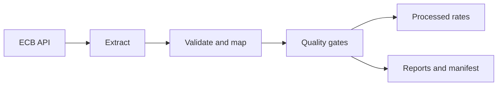

# ECB Market Data Pipeline in C Sharp

[](https://github.com/gbadedata/ecb-market-data-pipeline/actions/workflows/ci.yml)
[](https://github.com/gbadedata/ecb-market-data-pipeline/actions/workflows/scheduled-ingestion.yml)

A small, production-style C# and .NET 8 pipeline that extracts official European Central Bank foreign-exchange reference rates, validates the source contract, applies data-quality gates and publishes reproducible analytical files.

The default run covers GBP, USD, JPY and CHF against the euro. It is intentionally narrow enough to review end to end while demonstrating API integration, defensive parsing, idempotent data loading, provenance, automated testing and scheduled updates.

## What the pipeline demonstrates

| Employer requirement | Evidence in this repository |
| --- | --- |
| Extract and integrate data from APIs | Typed ECB API client with date and currency parameters |
| Clean and format source data | Contract-aware CSV parser and canonical FX schema |
| Build reliable update scripts | Idempotent merge keyed by date, base currency and quote currency |
| Assure data integrity | Duplicate, range, positivity, completeness and freshness rules |
| Document data and processes | Data contract, architecture notes, manifests and source hashes |
| Produce quantitative indicators | Per-currency coverage, record count, latest date and staleness |
| Use Git and delivery controls | Pull-request CI plus scheduled weekday ingestion |
| Apply C# accurately | .NET solution, interfaces, async HTTP, records, decimal rates and xUnit tests |

## Processing flow



## Authoritative source

The project uses the [ECB Data Portal API](https://data.ecb.europa.eu/help/api/overview) and its `EXR` exchange-rate dataflow. The default series keys follow the documented structure, for example `D.GBP.EUR.SP00.A` for the daily pound sterling reference rate against the euro. See the [ECB data examples](https://data.ecb.europa.eu/help/api/data-examples) and this repository's [data contract](docs/data-contract.md).

## Run locally

Prerequisite: .NET 8 SDK.

```bash
dotnet restore EcbMarketData.sln
dotnet build EcbMarketData.sln --configuration Release
dotnet test EcbMarketData.sln --configuration Release --no-build

dotnet run --project src/EcbMarketData -- \
  --start 2026-08-01 \
  --end 2026-09-19 \
  --currencies GBP,USD,JPY,CHF \
  --output data/output
```

Run `dotnet run --project src/EcbMarketData -- --help` to print the supported command format. Defaults are the latest 30 calendar days, the four currencies above and `data/output`.

## Outputs

```text
data/output/
├── raw/<run-id>/<currency>.csv
├── processed/ecb_fx_rates.csv
└── reports/
    ├── <run-id>-manifest.json
    ├── <run-id>-quality-report.json
    ├── latest-manifest.json
    └── latest-quality-report.json
```

- Raw payloads are retained unchanged.
- The manifest records the exact request, fetch time, byte count and SHA-256 digest.
- The processed file uses a stable business key and does not duplicate records on a retry.
- Failed quality gates prevent the processed file from being updated, while diagnostic evidence is still written.

## Quality controls

The pipeline fails on an unexpected base or quote currency, malformed or non-positive rate, out-of-window date, duplicate business key, missing requested currency or stale latest record. Coverage below 90% is a warning because legitimate ECB holidays can remove weekday observations.

Details are in [the data contract](docs/data-contract.md). Architectural decisions and limitations are documented in [the architecture note](docs/architecture.md).

## Tests and automation

The xUnit suite covers:

- quoted and malformed CSV records;
- ECB URL and series-key construction;
- source-to-canonical field mapping;
- duplicate, positivity, freshness and coverage rules;
- repeat-run idempotency through the real file store.

GitHub Actions builds with warnings treated as errors, runs the tests with coverage collection and retains test evidence. A separate weekday workflow executes live ingestion and uploads the complete output bundle as an artifact.

The committed CSV fixture is synthetic and exists only for deterministic tests. It must not be presented as an ECB observation extract.

## CV-ready description after CI passes

> Built a C#/.NET 8 market-data pipeline that ingests ECB FX reference rates through an SDMX API, validates source contracts and freshness, performs idempotent updates, and publishes traceable datasets with automated tests and scheduled GitHub Actions runs.

## Licence

MIT
