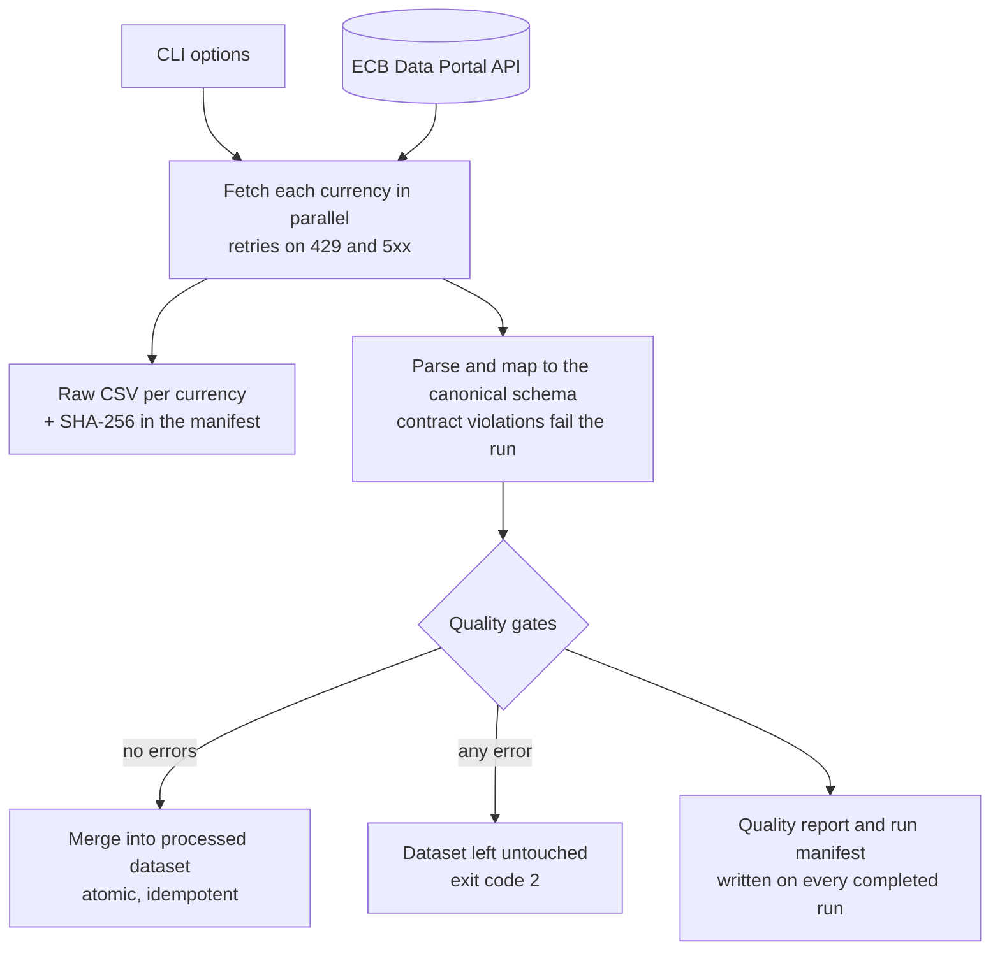

# ECB FX Market Data Pipeline

[](https://github.com/gbadedata/ecb-market-data-pipeline/actions/workflows/ci.yml)
[](https://github.com/gbadedata/ecb-market-data-pipeline/actions/workflows/scheduled-ingestion.yml)
[](https://dotnet.microsoft.com/download/dotnet/8.0)
[](LICENSE)

**A C# / .NET 8 pipeline that ingests the European Central Bank's daily FX reference rates, checks them
against an explicit data contract, and publishes an idempotent dataset with a verifiable record of
exactly where every number came from.**

By default it ingests GBP, USD, JPY and CHF against EUR. It is deliberately small enough to review end
to end, yet it carries the controls a production ingestion job needs: bounded retries, strict parsing,
blocking quality gates, idempotent and atomic writes, SHA-256 provenance for every source payload, and a
scheduled run on GitHub Actions every weekday.

> ECB reference rates are published for information. They are not a real-time feed or tradable prices.

### It runs every weekday

The latest scheduled run, on 6 November 2026, printed this summary (one of the four currency metrics shown):

```json
{
  "run_id": "20261106T220603879Z-1b2069ea",
  "source_count": 4,
  "extracted_observation_count": 136,
  "stored_observation_count": 136,
  "quality": {
    "requested_start_date": "2026-09-22",
    "requested_end_date": "2026-11-06",
    "currency_metrics": [
      { "currency": "CHF", "expected_weekdays": 34, "actual_observations": 34,
        "weekday_coverage_ratio": 1, "latest_observation_date": "2026-11-06", "staleness_days": 0 }
    ],
    "issues": [],
    "passed": true
  }
}
```

Four currencies × 34 weekdays = 136 observations, complete and same-day fresh, extracted, checked and
published in under a second. Of the 36 runs from the first on 19 September to 7 November 2026, **35
succeeded**. The one failure was an ECB request timing out, which the pipeline misreported as a
user cancellation; that is now fixed (see [Exit codes](#exit-codes)).

---

## Contents

- [Engineering guarantees](#engineering-guarantees)
- [Quick start](#quick-start)
- [How it works](#how-it-works)
- [Data source](#data-source)
- [Command-line options](#command-line-options)
- [Outputs](#outputs)
- [Verify the provenance yourself](#verify-the-provenance-yourself)
- [Quality controls](#quality-controls)
- [Exit codes](#exit-codes)
- [Automation](#automation)
- [Tests](#tests)
- [Known limitations](#known-limitations)
- [Repository structure](#repository-structure)

## Engineering guarantees

| Capability | Implementation |
| --- | --- |
| Authoritative source | ECB Data Portal SDMX 2.1 API, `EXR` dataflow, one explicit series key per currency |
| Resilient HTTP | currencies fetched in parallel; 45-second timeout; HTTP 429 and 5xx retried up to 4 attempts with exponential backoff (250 ms, 500 ms, 1 s), honouring a `Retry-After` of up to 30 s |
| Strict contract | required columns, row widths, ISO dates and invariant-culture decimals are enforced; malformed input fails the run instead of being dropped |
| Quality gates | 7 blocking rules and 1 warning; any error stops the dataset update |
| Idempotent publication | merged on observation date + base currency + quote currency; re-running never duplicates a row |
| Atomic writes | every file is written to a temporary file in the same folder and moved into place |
| Provenance | raw response kept per run; manifest records request URI, retrieval time, UTF-8 byte count and SHA-256 |
| Build policy | nullable reference types, latest recommended analyzers and code-style rules, warnings treated as errors, deterministic builds |

## Quick start

Requires the [.NET 8 SDK](https://dotnet.microsoft.com/download/dotnet/8.0).

```bash
dotnet restore EcbMarketData.sln
dotnet build EcbMarketData.sln --configuration Release --no-restore
dotnet test EcbMarketData.sln --configuration Release --no-build

dotnet run --project src/EcbMarketData/EcbMarketData.csproj --configuration Release --no-build -- \
  --start 2026-10-01 --end 2026-10-31 --currencies GBP,USD,JPY,CHF --output data/output
```

Both dates are inclusive. The run prints a JSON summary like the one above and exits non-zero if
extraction, validation or publication fails. `--help` prints the usage line.

## How it works



1. **Extract.** One request per currency, all in parallel, each for the series `D.{CURRENCY}.EUR.SP00.A`.
2. **Map.** The CSV response is parsed by the project's own RFC 4180-aware parser (quoted fields,
   escaped quotes, CRLF and LF, byte-order marks) and mapped to the canonical schema.
3. **Check.** The quality rules run over this run's observations and produce a report.
4. **Publish.** Raw responses, the quality report and the manifest are always written. The processed
   dataset is updated only when no rule fails with an error.

What a failure leaves behind:

| Failure | Raw files and reports | Processed dataset | Exit code |
| --- | --- | --- | --- |
| a quality rule fails with an error | written, for diagnosis | unchanged | 2 |
| a request fails, times out, or the response breaks the contract | not written | unchanged | 1 |

The pipeline depends only on two small interfaces, `IEcbDataSource` and `IMarketDataStore`, so the ECB
client or the file store can be swapped (for a database, say) without touching extraction or quality
logic. [Architecture and decisions](docs/architecture.md) explains the choices.

## Data source

The pipeline calls the [ECB Data Portal API](https://data.ecb.europa.eu/help/api/overview) using the
`EXR` dataflow. Each currency uses this series key:

```text
D.{QUOTE_CURRENCY}.EUR.SP00.A        e.g. D.GBP.EUR.SP00.A
```

Each observation is units of the quote currency per EUR 1. The request asks for CSV with
`detail=dataonly`; the ECB's [data request examples](https://data.ecb.europa.eu/help/api/data-examples)
show the same URL pattern. The full field-level contract is in [docs/data-contract.md](docs/data-contract.md).

## Command-line options

| Option | Default | Description |
| --- | --- | --- |
| `--start YYYY-MM-DD` | 30 days before today (UTC) | first observation date requested |
| `--end YYYY-MM-DD` | today (UTC) | last observation date requested; must not be before `--start` |
| `--currencies GBP,USD,...` | `GBP,USD,JPY,CHF` | ISO 4217 codes; upper-cased, deduplicated and sorted |
| `--output PATH` | `data/output` | root folder for raw, processed and report files |
| `--max-staleness-days N` | `7` | largest allowed gap between `--end` and the latest observation |
| `--base-url URL` | `https://data-api.ecb.europa.eu/` | API endpoint; must be HTTPS, except `localhost`, which is allowed for testing |

Unknown options, repeated options and missing values are rejected with exit code 64.

## Outputs

```text
data/output/
├── raw/
│   └── <run-id>/                     one folder per run, never overwritten
│       ├── chf.csv  gbp.csv  jpy.csv  usd.csv
├── processed/
│   └── ecb_fx_rates.csv              the published dataset
└── reports/
    ├── <run-id>-manifest.json        sources, URIs, byte counts, SHA-256
    ├── <run-id>-quality-report.json  per-currency metrics and issues
    ├── latest-manifest.json
    └── latest-quality-report.json
```

A run ID is the UTC start time plus a random suffix, for example `20261106T220603879Z-1b2069ea`.

**Processed schema** (`processed/ecb_fx_rates.csv`), one row per business key, sorted by date then currency:

| Field | Type | Definition |
| --- | --- | --- |
| `observation_date` | date | ECB observation date, `YYYY-MM-DD` |
| `base_currency` | string | always `EUR` |
| `quote_currency` | string | the requested currency, such as `GBP` |
| `rate` | decimal | units of quote currency per EUR 1, written without trailing zeros (`0.8650` is stored as `0.865`) |
| `status` | string | ECB observation status; `A` when the response omits it |
| `source_series` | string | the ECB series key the row came from |
| `ingested_at_utc` | timestamp | when the source was retrieved, ISO 8601 round-trip format |

When a later run returns a value for a date already in the dataset, the newer row replaces the older one.

## Verify the provenance yourself

The manifest's `sha256` is the digest of the raw file exactly as written to disk, so anyone can check
that a published number came from an untouched source payload:

```bash
RUN=$(jq -r .run_id data/output/reports/latest-manifest.json)
sha256sum data/output/raw/$RUN/gbp.csv
jq -r '.sources[] | select(.currency == "GBP") | .sha256' data/output/reports/latest-manifest.json
# the two digests match
```

## Quality controls

| Rule | Severity | Fails when |
| --- | --- | --- |
| `base_currency` | Error | an observation is not against EUR |
| `requested_currency` | Error | the response contains a currency that was not requested |
| `positive_rate` | Error | a rate is zero or negative |
| `requested_date_range` | Error | an observation falls outside the requested dates |
| `unique_business_key` | Error | two rows share a date, base and quote currency |
| `currency_present` | Error | a requested currency returned no observations |
| `freshness` | Error | the latest observation is more than `--max-staleness-days` before `--end` |
| `weekday_coverage` | Warning | fewer than 90% of weekdays in the period have an observation |

Weekday coverage is a warning, not an error, because ECB holidays leave legitimate gaps. Each report
also records, per currency, the expected weekdays, the observations received, the coverage ratio, the
latest date and the staleness in days.

## Exit codes

| Code | Meaning |
| ---: | --- |
| `0` | completed; no blocking quality issue |
| `1` | failed: an HTTP error, a request timeout, a contract violation, or a storage error |
| `2` | completed, but at least one blocking quality rule failed; the dataset was not updated |
| `64` | invalid command-line arguments |
| `130` | cancelled with Ctrl+C |

Earlier versions exited with `130` when an ECB request hit the 45-second timeout, because .NET reports
an `HttpClient` timeout as a cancellation. That is what happened to the one failed scheduled run, on
6 October 2026. A timeout now exits with `1` and names the timeout; only a real Ctrl+C exits with `130`.

## Automation

**Continuous integration** ([`ci.yml`](.github/workflows/ci.yml)) runs on every push and pull request
to `main`: restore, a Release build with warnings as errors, the test suite with coverage collection,
and test results kept as an artifact for 14 days.

**Scheduled ingestion** ([`scheduled-ingestion.yml`](.github/workflows/scheduled-ingestion.yml)) is
scheduled for 17:15 UTC every weekday and ingests a rolling 45-day window. The full output (raw files,
processed dataset and reports) is kept as a workflow artifact for 30 days; generated data is never
committed. GitHub starts scheduled runs late when it is busy, and here they have started 2.7 to 6.6
hours after 17:15. The ECB publishes its reference rates at around 16:00 CET on working days, so even a
delayed run collects that day's rates.

Run it on demand with a different window (1 to 3,650 days):

```bash
gh workflow run scheduled-ingestion.yml -f lookback_days=90
```

**Dependabot** opens a pull request each month when a NuGet package or GitHub Action has an update.

## Tests

```bash
dotnet test EcbMarketData.sln --configuration Release
```

Nine xUnit tests, all deterministic and offline. They use a clearly labelled synthetic CSV fixture; the
live API is exercised by the scheduled workflow.

| Test class | Tests | Covers |
| --- | --- | --- |
| `EcbApiClientTests` | 1 | request URI and series-key construction |
| `CsvDocumentTests` | 2 | quoted commas and escaped quotes; rejecting a row with the wrong number of fields |
| `FxObservationMapperTests` | 1 | mapping the ECB columns to the canonical schema |
| `IngestionOptionsTests` | 2 | currency normalisation and deduplication; rejecting an inverted date range |
| `DataQualityEvaluatorTests` | 2 | a clean dataset passes with full coverage; duplicate keys and a zero rate fail |
| `MarketDataPipelineTests` | 1 | two identical runs through the real file store leave two rows, not four |

Not yet covered by an automated test: the retry and backoff behaviour; the `base_currency`,
`requested_currency`, `requested_date_range`, `currency_present`, `freshness` and `weekday_coverage`
rules; and the rule that a failed quality gate leaves the processed dataset untouched. A failing run
(exit code 2, `requested_currency` and `currency_present` errors, dataset unchanged) was checked by hand
against a local stub server when this README was written, but these behaviours deserve automated tests.

Collect coverage locally:

```bash
dotnet test EcbMarketData.sln --configuration Release \
  --collect:"XPlat Code Coverage" --results-directory TestResults
```

## Known limitations

- **No holiday calendar.** Weekday coverage counts ECB holidays as missing days, which can raise
  expected warnings.
- **Only HTTP status codes are retried.** A timeout or a dropped connection fails the run at once; the
  next scheduled run picks the data up, because each run re-reads a 45-day window.
- **File-backed storage** suits a small analytical workload, not concurrent writers or high volume.
- **Reference rates only:** daily published values, not intraday ticks or executable prices.
- **Outputs expire.** Scheduled outputs live in 30-day workflow artifacts rather than a database or
  object store; the `IMarketDataStore` interface is the extension point for durable storage.

## Repository structure

```text
.
├── src/EcbMarketData/
│   ├── Program.cs                     entry point, exit codes
│   ├── Configuration/                 command-line parsing and validation
│   ├── Infrastructure/                ECB client, CSV parser, file store
│   ├── Pipeline/                      orchestration, mapping, quality rules
│   └── Domain/                        observations, reports, manifest
├── tests/EcbMarketData.Tests/         xUnit suite and synthetic fixture
├── docs/                              architecture and data contract
├── .github/                           CI, scheduled ingestion, Dependabot
├── Directory.Build.props              shared compiler and analyzer policy
├── global.json                        .NET SDK selection
└── EcbMarketData.sln
```

## Licence

[MIT](LICENSE).
