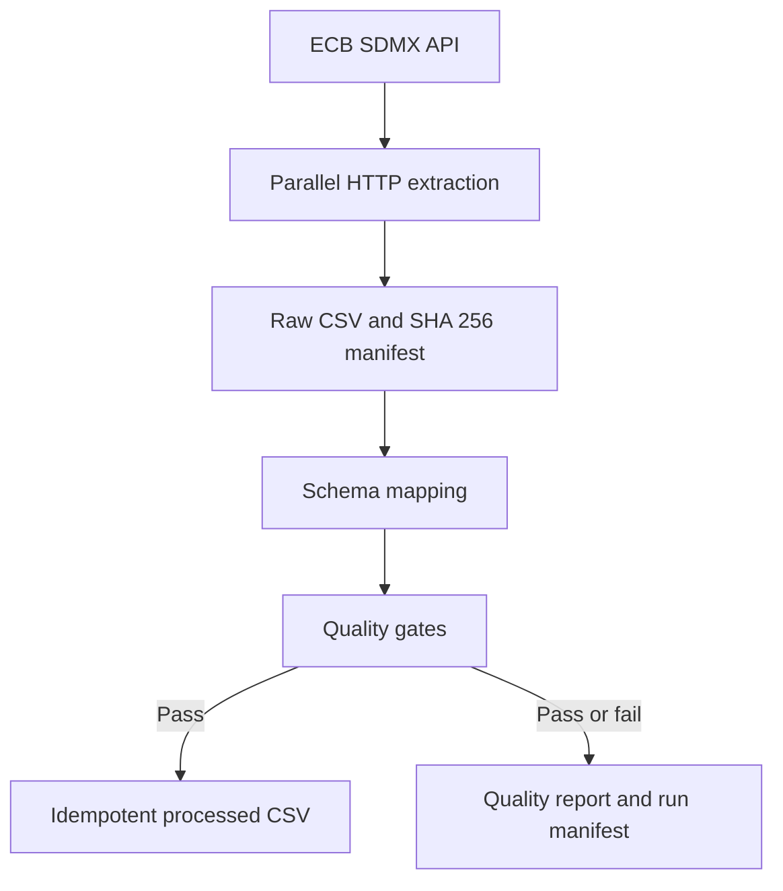

# Architecture and decisions

## Processing flow

## Design choices

### File-backed outputs

This repository deliberately uses CSV and JSON outputs. They keep the project small, make every run easy to inspect during code review and avoid requiring credentials or infrastructure. The `IMarketDataStore` boundary allows a database implementation to replace the file store without changing extraction or quality logic.

### No production dependency for CSV parsing

The application includes an RFC 4180-aware parser for the ECB response instead of depending on a third-party CSV package. It handles quoted commas, escaped quotes, CRLF and LF newlines, byte-order marks and inconsistent row widths. Tests cover the behaviours the pipeline relies on.

### Idempotency

The canonical business key is observation date, base currency and quote currency. Existing and incoming rows are merged by this key, so retries update records rather than creating duplicates.

### Failure behaviour

The extractor retries HTTP 429 and 5xx responses with bounded exponential backoff and honours a short `Retry-After` value. Contract violations and failed quality gates stop processed-data publication. Raw inputs and quality evidence are still retained for diagnosis.

### Operational automation

The CI workflow builds with warnings treated as errors and runs the test suite. A separate weekday workflow ingests the latest ECB data and publishes raw, processed and quality outputs as a time-limited workflow artifact; it does not write generated data back to the repository.

## Known limitations

- Weekday coverage does not use an ECB holiday calendar, so holidays can create expected warnings.
- File storage is appropriate for a portfolio-sized workload, not concurrent high-volume ingestion.
- The project ingests published reference rates, not real-time tradable prices.
- Live API behaviour is tested by the scheduled workflow; unit tests use a clearly labelled synthetic fixture.
